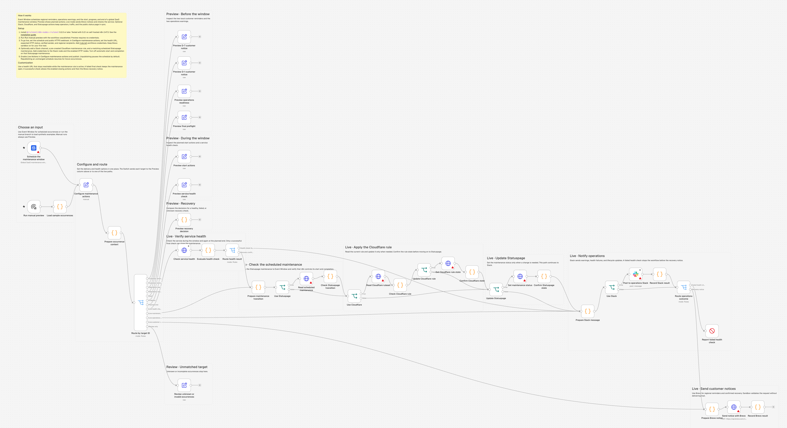

# Orchestrate a global SaaS maintenance window

One rrule.net Event Window schedules customer notices, operations warnings,
and maintenance phases. The workflow starts in Preview mode. In live mode,
Brevo sends regional reminders and the recovery notice, and n8n checks a
configurable health URL during the window and at the planned end.
Optional Slack, Cloudflare, and Statuspage actions cover operations alerts,
traffic changes, and public status updates.

## Import and preview

1. Install `@rrulenet/n8n-nodes-rrulenet` **0.2.0 or later** on a self-hosted
   instance. Follow the [community node installation guide](https://docs.n8n.io/integrations/community-nodes/installation-and-management/).
2. Import [maintenance-window.workflow.json](./maintenance-window.workflow.json)
   using **Import from File**.
3. With the workflow unpublished, select **Run manual preview** from the
   trigger picker next to **Execute workflow**. Open the output nodes to inspect
   the fixture results. The manual run requires no credentials.

The submission export was imported and previewed on self-hosted n8n 2.47.3
with `@rrulenet/n8n-nodes-rrulenet` 0.2.1. On n8n Cloud, the installed verified
version must include Event Window.

The 21 fixtures exercise every preview route, including missing IDs, an unknown
target, an invalid timestamp, and a replay with a different execution ID. The
planned end includes healthy, unhealthy, and unknown recovery scenarios. The
manual trigger always runs in Preview, even after you enable live actions.

## Schedule

The example runs from **00:30 to 02:30 UTC on March 28, 2027**, across the Paris
clock change. The trigger generates 13 targets from four IANA time zones
(Paris, New York, Tokyo, Perth), two reminders, two warnings, and three
lifecycle phases. Use a new future window when adapting the workflow.

| Target ID | Timing | Action |
| --- | --- | --- |
| `customer-reminder-7d-<region>` | Seven local calendar days before at 09:00 | Localized Brevo reminder |
| `customer-reminder-1d-<region>` | One local calendar day before at 09:00 | Localized Brevo reminder |
| `ops-warning-2h` | Two elapsed hours before | Post an operations readiness reminder in Slack |
| `ops-warning-15m` | Fifteen elapsed minutes before | Post the final preflight reminder in Slack |
| `maintenance-start` | Exact start | Enable the Cloudflare rule, set Statuspage to In progress, and notify Slack |
| `maintenance-progress` | Every ten elapsed minutes from start through 02:20 UTC in the example | Check service health and record the result in n8n |
| `maintenance-end` | Exact end | Run a fresh health check. On success, disable the rule, complete Statuspage, and send recovery notices. On failure, alert Slack. |

The trigger keeps progress on a UTC grid and gives start and progress distinct
target IDs even when they occur at the same instant. Customer notices use the
local calendar date of the start in each audience's time zone.

## Configure live actions

1. Set the event ID, future bounds with explicit offsets, and audiences on
   **Schedule the maintenance window**. Add an rrule.net API credential and
   expose a public HTTPS production webhook URL. Publishing registers the
   schedule with rrule.net. By default, unpublishing pauses it. Publishing the
   same schedule again resumes future occurrences. It skips earlier reminders
   and other elapsed occurrences.
2. Add an n8n **Brevo** credential with a transactional API key to **Send
   notice with Brevo**. Use a verified sender in your Brevo account.
3. In **Configure maintenance actions**, set the following fields.

   | Field | Purpose |
   | --- | --- |
   | `health_url` | HTTP(S) URL reachable from n8n. Choose an endpoint that reflects actual service health. |
   | `healthy_status` | Exact HTTP success code expected from that URL, default `200`. Use a 2xx code. |
   | `sender_email` | Verified Brevo sender address. |
   | `service_name` | Name used in the email subject and body. |
   | `regional_recipients` | JSON object mapping each Event Window audience ID to an array of email addresses. Leave an array empty to skip that audience. |
   | `enable_live_actions` | `false` keeps all scheduled executions in Preview. Set it to `true` to enable configured actions on published executions. |
   | `brevo_sandbox` | `true` asks Brevo to validate the request and drop the email. Set it to `false` after confirming the configuration with a test audience. |

4. Publish the workflow and check the execution history. A sandbox acceptance
   confirms that Brevo accepted the request. To check actual delivery, use a
   test mailbox with sandbox off before adding customer addresses. [Brevo sandbox](https://developers.brevo.com/docs/using-sandbox-mode)

Reminders go to the matching audience. The recovery notice goes to the union
of configured audiences, once per address per execution. Each request contains
one recipient. English, French, and Japanese messages are included. Reminder
dates use the audience's configured locale and time zone. Keep the `7d`, `1d`,
`2h`, and `15m` phase IDs, or update the routing and notice rules when renaming them.

### Optional operations integrations

Set the corresponding fields in **Configure maintenance actions**. Blank IDs
skip that service. Keep tokens in n8n credentials.

| Service | Configuration |
| --- | --- |
| **Slack** | Set `slack_channel_id` to your test channel ID. In **Post to operations Slack**, use the native Slack node's **Access Token** credential with a bot token that has `chat:write`. Add the bot to the channel. [Slack node](https://docs.n8n.io/integrations/builtin/app-nodes/n8n-nodes-base.slack/) · [Slack permissions](https://docs.slack.dev/reference/methods/chat.postMessage/) |
| **Cloudflare** | Pre-create a disabled Block or Redirect rule for the test hostname, with the health URL outside the rule expression. Set `cloudflare.zone_id`, `ruleset_id`, and `rule_id` in the `cloudflare` object. Select the same zone-scoped Cloudflare API credential on **Read Cloudflare ruleset** and **Set Cloudflare rule state**. Grant read and write access for the ruleset's phase. [Cloudflare rule API](https://developers.cloudflare.com/ruleset-engine/rulesets-api/update-rule/) |
| **Statuspage** | Pre-create a scheduled maintenance with the same start and end as Event Window. Turn off automatic start and completion. Set `statuspage.page_id` and `incident_id` in the `statuspage` object. Select the same Header Auth credential on **Read scheduled maintenance** and **Set maintenance status**, using `Authorization` as the header name and `OAuth <api-key>` as the value. Status updates leave subscriber notifications off. [Scheduled maintenance](https://support.atlassian.com/statuspage/docs/schedule-maintenance/) · [Statuspage API](https://developer.statuspage.io/) |

## Recovery and retries

The end target runs its own GET with a ten-second timeout. The recovery branch
requires the occurrence timestamp to match the configured end and the response
to match `healthy_status`. Redirects, unexpected status codes, and connection
failures alert the configured Slack channel and fail the execution before
changing Cloudflare or Statuspage or sending Brevo mail. On success, the enabled
Cloudflare and Statuspage changes must be confirmed before Brevo sends the
recovery notice. A Slack delivery error is visible in the execution and leaves
the customer notice path available.

The workflow reads the current Cloudflare and Statuspage states and skips writes
when the target state is already set. After a failed health check or API call,
inspect the applied changes and resolve the problem. For an automated recovery,
redeliver the original end occurrence to the production trigger webhook so the
workflow runs a fresh health check. n8n's execution retry can resume at the failed
node using the previous health result. Redelivery can repeat the Slack message.
Use one window at a time per Cloudflare rule.

Statuspage updates include the components already associated with the scheduled
maintenance. They move to `under_maintenance` on start and to `operational` only
after the final health check succeeds. The workflow checks both the maintenance
status and the returned component statuses before continuing.

Each Brevo request uses a stable idempotency key derived from the occurrence,
recipient, and sandbox setting. A replay within Brevo's deduplication window
is skipped when Brevo reports that it already processed the key. A later replay
can send again. If you need protection beyond that window, record successful
sends in a durable store keyed by occurrence and recipient. [Brevo idempotency](https://developers.brevo.com/changelog/2021/11/10)

## Workflow canvas

Start with the inputs on the left. The Switch sends Preview occurrences up to
the Preview column and unrecognized occurrences down to Review. Follow the
live path from left to right through the health check, Cloudflare, Statuspage,
and Slack. Brevo notices sit below the main path on the right.

